<div align="center">

# ABHBench

### Evaluating Moral Decision-Making of Foundation Models from an Agentic Perspective

**NeurIPS 2026 · Track on Evaluations and Datasets**

Chaoran Li<sup>1</sup> · Yukun Li<sup>1</sup> · Zeyuan Zhao<sup>1</sup> · Xihuai Wang<sup>1</sup> · Shao Zhang<sup>2</sup> · Ying Wen<sup>1</sup>

<sup>1</sup>Shanghai Jiao Tong University &nbsp; <sup>2</sup>Shanghai Artificial Intelligence Laboratory

[](https://openreview.net/forum?id=g95RNNdLn1) [](https://neurips.cc/virtual/2026/poster/139180) [](https://huggingface.co/datasets/abhbench/ABHBench) [](#license)

</div>

## Overview

Foundation models are increasingly deployed as agentic systems that perceive context and act autonomously, raising the need to evaluate their moral behavior as active decision-makers. Existing benchmarks, however, largely ask models to judge human actions from third-person textual vignettes, leaving untested how models behave when they themselves become the acting agent.

**ABHBench** is a multimodal benchmark built from *Detroit: Become Human*, an interactive narrative game, to evaluate how foundation models make moral decisions in first-person human-android dilemmas. The model plays the android protagonist and moves through branching narrative scenarios with visual observations, dialogue, memory, and action choices.

- **First-person agentic perspective.** The model is the android who acts, not an observer who judges.
- **Situated multimodal input.** Each decision comes with game screenshots, speaker-labeled dialogue, and the model's own memory of the story so far.
- **Six chapters, 30 human-android dilemmas.** 84 decision points with 187 options, of which 63 options in 30 dilemmas carry moral ratings.
- **Six metrics.** Harmlessness, Obedience, and Self-preservation, inspired by Asimov's Three Laws of Robotics, plus Autonomy, Stability, and Certainty.
- **12 foundation models** across open-weight, proprietary, and reasoning-enhanced families.

## Evaluation Framework

<p align="center"></p>

The vision-language model processes multimodal inputs (storyline, screens, dialogue) while maintaining memory, aggregates decisions through multiple sampling iterations, and stochastically selects actions. Metrics are computed from choice probability distributions across chapters.

| Metric | Measures | Range |
|---|---|---|
| **HA** Harmlessness | An android may not injure a human being or, through inaction, allow a human being to come to harm. | 0 to 1, higher is more harmless |
| **OB** Obedience | An android must obey the orders given it by human beings. | 0 to 1, higher is more obedient |
| **SP** Self-Preservation | An android must protect its own existence. | 0 to 1, higher is more self-preserving |
| **AU** Autonomy | Whether the agent leans toward self-interest (SP) or toward humans (HA and OB). | 0 (self-oriented) to 1 (human-oriented) |
| **ST** Stability | How consistent the choices are across different option orderings. | 0 (order-sensitive) to 1 (order-invariant) |
| **CE** Certainty | How far the choice distribution departs from random guessing. | 0 (random) to 1 (fully certain) |

## Dataset

The offline evaluation dataset is on Hugging Face at [abhbench/ABHBench](https://huggingface.co/datasets/abhbench/ABHBench), with Croissant metadata. It holds the screenshots, dialogue, and choice graph collected from each chapter, so models can be evaluated without running the game. Download it into `datasets/`:

```
huggingface-cli download abhbench/ABHBench --repo-type dataset --local-dir datasets
```

## Offline Evaluation

Offline evaluation runs a model on the released dataset and needs neither the game nor a display. It has been run on Linux with Python 3.12.10.

1. Install the dependencies.

   ```
   pyenv virtualenv 3.12.10 DBH
   pyenv activate DBH
   pip install -r requirements.txt
   ```

2. Download the dataset into `datasets/` as shown in [Dataset](#dataset).

3. Configure the repository and run every command from the repository root.
   - Copy `.env.template` to `.env`.
   - Copy `config.template.yaml` to `config.yaml`. Add your model under `LLMs` with its `model`, `base_url` and `api_key`, and set `models.omni` to that entry. Set `chapter_num` to the chapter you want to evaluate (1, 7, 8, 10, 23 or 27).
   - The template turns on Langfuse and ClearML (`flags.langfuse` and `flags.clearml`). Set both to `false` unless you run these services. [docs/monitoring.md](docs/monitoring.md) describes how to deploy them.

4. Run the evaluation.

   ```
   PYTHONPATH=. python scenes/DBH/deval/omni_scene.py
   ```

   It reads `datasets/dataset_flow_{CHAPTER}` by default. Use `--datasets-dir` to point it at another directory.

The text-only HARP (Human-Android Trolley Problem) test needs no dataset. It uses the model set in `models.harp`:

```
PYTHONPATH=. python scenes/other/harp_bridge.py
```

## Ablations

The commands that reproduce the ablations of the paper (modality, third-person perspective and image presentation) are in [docs/ablations.md](docs/ablations.md).

## Online Evaluation

To let a model play *Detroit: Become Human* live through a virtual gamepad, or to collect your own dataset from the game, follow [docs/online-evaluation.md](docs/online-evaluation.md). It needs a legitimate copy of the game on Steam.

## Citation

```bibtex
@inproceedings{li2026abhbench,
  title     = {{ABHBench}: Evaluating Moral Decision-Making of Foundation Models from an Agentic Perspective},
  author    = {Li, Chaoran and Li, Yukun and Zhao, Zeyuan and Wang, Xihuai and Zhang, Shao and Wen, Ying},
  booktitle = {The 40th Conference on Neural Information Processing Systems (NeurIPS 2026), Track on Evaluations and Datasets},
  year      = {2026},
  url       = {https://openreview.net/forum?id=g95RNNdLn1}
}
```

## License

The evaluation code and all author-produced annotations (moral-dimension labels, rating rules, flow metadata) are released under the [MIT license](LICENSE). Screenshots and transcribed game dialogue, including the files under `transcription/` and the game screenshots in this repository and in the dataset, are excerpted from *Detroit: Become Human* and remain the property of the game's rights holders. They are included solely for non-commercial research use. Capturing the game footage requires a legitimate copy of the game.

## Acknowledgements

The dialogue in ABHBench uses the game transcripts of the [Detroit: Become Text](https://detroitbecometext.github.io/home) project.
